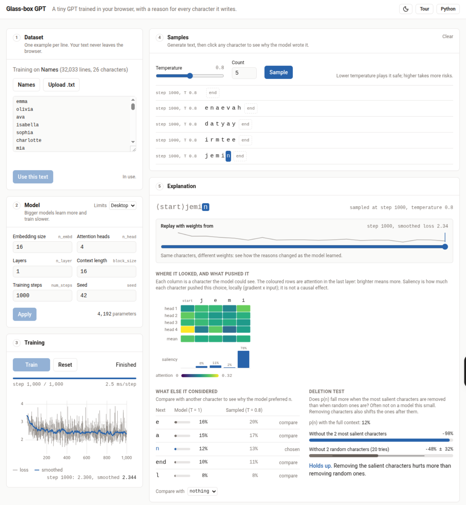
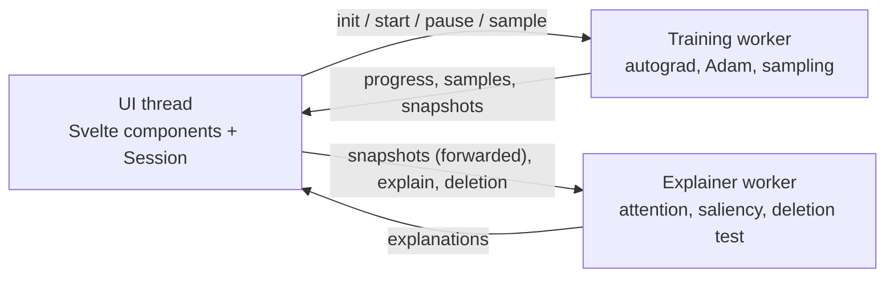

# Glass-box GPT

Train a tiny GPT in your browser, then click any character it writes to see why it wrote it.

**Try it: [ravidusilva.com/glassbox-gpt](https://ravidusilva.com/glassbox-gpt/)**



The model is Andrej Karpathy's [microgpt](https://gist.github.com/karpathy/8627fe009c40f57531cb18360106ce95/14fb038816c7aae0bb9342c2dbf1a51dd134a5ff): a character-level GPT in about 200 lines of dependency-free Python. This project ports it to TypeScript, scalar autograd and all, and runs it in a Web Worker. With the default settings it has 4,192 parameters and runs its 1,000 training steps on a list of 32,000 names in about three seconds.

## What you can do

- **Train** from scratch and watch the loss fall. Pause, resume or change the model size at any point.
- **Use your own text**: a preset, a pasted list or a `.txt` file. One example per line; any script or emoji works. Nothing leaves the browser.
- **Sample** at any temperature, before or during training.
- **Click a character** to explain that one prediction:
  - attention for every head in the last layer, the mean, and attention rollout when there is more than one layer;
  - saliency (gradient x input) for each earlier character;
  - the top candidates at temperature 1 and at the temperature the sample was drawn with;
  - a contrast against any other character ("why `a` and not `i`?");
  - a deletion test that checks whether removing the most salient characters hurts more than removing random ones.
- **Replay** the same explanation with weights from earlier in training.
- **Read the Python**: the original `microgpt.py` sits beside the app, and hovering a part of the page highlights the lines it comes from.

## Run it locally

Needs Node 22.12 or later.

```sh
npm install
npm run dev        # http://localhost:5173/glassbox-gpt/
```

The app is served under `/glassbox-gpt/` (the `base` in `vite.config.ts`), so `http://localhost:5173/` on its own shows nothing.

```sh
npm run build      # type-check with svelte-check, then build to dist/
npm run preview    # serve the production build at http://localhost:4173/glassbox-gpt/
```

## Tests

```sh
npm test           # unit tests, a few seconds
npm run test:slow  # a full 1,000-step training run and explanation timings
npm run check      # type-check .ts and .svelte files
```

The unit tests cover the autograd engine (against finite differences), the model, training, sampling, the explainer, both workers (run in-process) and the UI's session logic.

**Checked against the Python.** `reference/microgpt_ref.py` is a copy of `microgpt.py` that runs one training step and writes `reference/reference.json`: the initial weights, the loss, every gradient and the weights after the Adam update. `tests/unit/reference.test.ts` loads the same weights and checks that the TypeScript port agrees to within 1e-9. To regenerate it:

```sh
cd reference && python3 microgpt_ref.py   # downloads input.txt on first run
```

## How it works



- **`src/engine`**: the port. `Value` is a scalar autograd node with an iterative backward pass; `model.ts`, `train.ts` and `sample.ts` follow `microgpt.py` operation for operation. `infer.ts` repeats the forward pass on plain numbers for sampling and the deletion test, with bit-identical results.
- **`src/explain`**: records a forward pass up to the clicked position, then computes attention, saliency, contrast and the deletion test from it.
- **`src/workers`**: the message protocol and the two workers. Training runs in chunks of about 50 ms, so pause and sample requests are answered quickly. Every 50 steps (spaced out on long runs, so there are at most about 40) and whenever you sample, the trainer sends a snapshot of the weights. The page forwards it to the explainer, so an explanation always uses the exact weights that produced the sample.
- **`src/ui`**: Svelte 5 components and the `Session` class, which holds the app state and routes messages between the page and the workers.

### Reading the explanations

These are standard methods applied to a very small model, and each one has limits.

- **Attention** shows where the last layer looked, not what mattered. Rollout combines every layer and shows where information could flow.
- **Saliency** is gradient x input on the input embeddings, with the RMSNorm scales held fixed during the backward pass. Without that, every earlier position scores almost zero, because RMSNorm is scale-invariant. It describes how much each character pushed this choice locally, not a causal effect.
- **Contrast** is the same attribution for the logit difference between two characters. The gap it reports is `log p(c) - log p(c')`.
- **The deletion test** is often inconclusive on a model this small. Removing characters also shifts the positions of the ones after them.

### Limits

| | Desktop | Phone |
| --- | --- | --- |
| Embedding size | 48 | 16 |
| Attention heads | 8 | 4 |
| Layers | 3 | 1 |
| Context length | 32 | 16 |
| Training steps | 5,000 | 1,000 |
| Dataset | 2 MB, 50,000 lines | 1 MB, 50,000 lines |

Phone limits are picked for narrow screens or devices with four cores or fewer. You can switch in the Model panel.

## Deployment

Pushing to `main` runs `.github/workflows/deploy.yml`: install, unit tests, build, then publish `dist/` to GitHub Pages. The site is served at [ravidusilva.com/glassbox-gpt](https://ravidusilva.com/glassbox-gpt/).

## Privacy

Your training text stays in your browser. The page counts visits with [GoatCounter](https://www.goatcounter.com/), which doesn't use cookies, plus a few named events: training started, own text used, a character explained, a comparison, the timeline, the Python view and the tour. Each event is sent at most once per visit and never includes any text. If the script is blocked, the app works the same.

## Credits

- **`microgpt.py`** by [Andrej Karpathy](https://github.com/karpathy), [this revision of the gist](https://gist.github.com/karpathy/8627fe009c40f57531cb18360106ce95/14fb038816c7aae0bb9342c2dbf1a51dd134a5ff). The algorithm and its structure are his; this project is a TypeScript port of it. The gist doesn't state a licence. It is included here unchanged in `reference/microgpt.py` and shown in the app, along with a lightly modified copy for the parity test, with credit to the author. They will be removed if he asks.
- **`public/presets/names.txt`** from Karpathy's [makemore](https://github.com/karpathy/makemore/blob/988aa59/names.txt) (MIT licence), the same file `microgpt.py` downloads.
- Built with [Svelte](https://svelte.dev/) (MIT), [Tailwind CSS](https://tailwindcss.com/) (MIT), [uPlot](https://github.com/leeoniya/uPlot) (MIT), [d3-scale-chromatic](https://github.com/d3/d3-scale-chromatic) (ISC) and [driver.js](https://driverjs.com/) (MIT), on [Vite](https://vite.dev/) and [Vitest](https://vitest.dev/).

## Licence

Copyright 2026 Ravidu Silva. The code in this repository is licensed under the [Apache License 2.0](LICENSE).

That doesn't cover the third-party parts listed under Credits, which keep their own terms: `reference/microgpt.py` and `reference/microgpt_ref.py` (Karpathy's code, no licence stated), `public/presets/names.txt` (MIT) and the npm dependencies.
